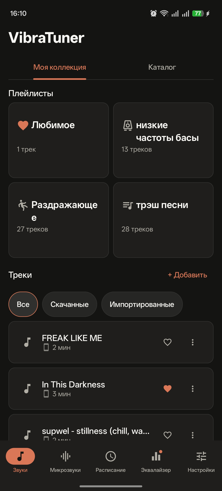
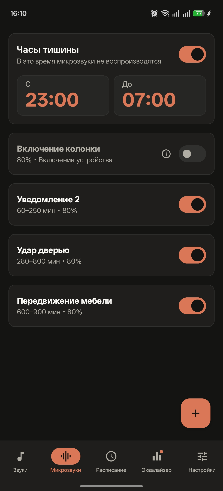
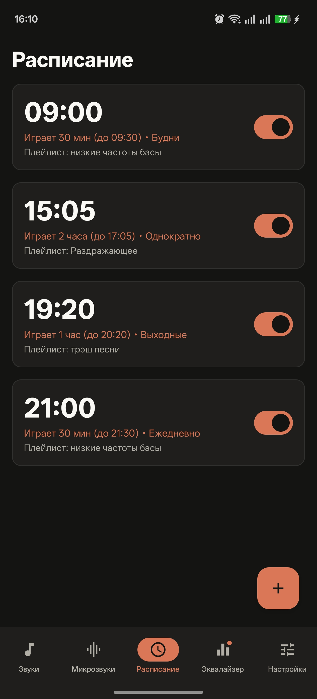
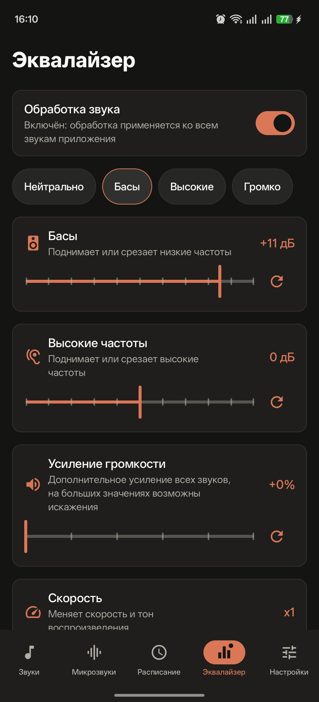
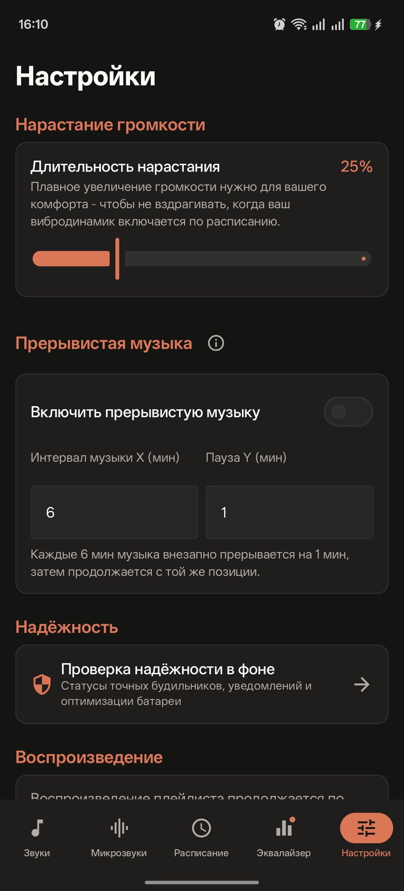

<div align="center">

# VibraTuner


**Удобный и эффективный инструмент борьбы с шумными соседями**  
Android-приложение для использования с вибродинамиком (виброколонкой). Содержит каталог плейлистов, расписание и различные режимы работы.

[](https://github.com/anichivo/VibraTuner/releases/latest)

</div>

---

## Скриншоты

<p align="center">
  
  
  
  
  
</p>

## Как скачать и установить

1. Нажмите зелёную кнопку **[Скачать APK](https://github.com/anichivo/VibraTuner/releases/latest)** выше (или перейдите в [раздел Releases](https://github.com/anichivo/VibraTuner/releases/)) и скачайте файл `.apk` из последнего релиза.
2. При открытии файла разрешите установку приложений из неизвестных источников для вашего браузера или файлового менеджера, и установите приложение. 

## Основные возможности

- **Готовые плейлисты** — различная музыка для виброколонки и различные звуки. Прослушивайте онлайн или скачивайте на устройство.
- **Расписание** — можно задать расписание «сеансов терапии», выбрать время и длительность.
- **Микрозвуки** — специальный режим для регулярного проигрывания коротких, но громких звуков. Помогает держать «терапируемых» в тонусе.
- **«Включение колонки» и фейк-включение** — короткий звук перед сеансом и случайная имитация включения колонки. Нужны для вырабатывания рефлексов и ассоциаций. Подробнее об этих функциях — в приложении.
- **Эквалайзер** — повышение нужных вам частот и понижение ненужных, усиливает акустическую проницаемость.

## Требования

- Android 12 или новее

## Прозрачность и политика конфиденциальности

Приложение не собирает никакие данные, аналитика отсутствует. Интернет используется только для встроенных плейлистов и проверки обновлений. 

## Важные формальности

Мы исходим из того, что используя VibraTuner, вы не нарушаете закон. Разработчик не несёт ответственности за любой ущерб — здоровью, сну, имуществу, нервам, финансам, отношениям с соседями и штрафы — прямой или косвенный, возникший в связи с использованием приложения. 


Приложение и его исходный код публикуется «как есть», без каких-либо гарантий. 

## Связь с разработчиком

- Вы можете написать мне в Telegram: [t.me/VibraTuner](https://t.me/VibraTuner?direct)

## Лицензия

Проект распространяется под лицензией [MIT](LICENSE).

---

<details>
<summary><h2>🛠 Техническая информация для опытных</h2></summary>
Я не имею опыта в разработке Android-приложений — это мой первый проект, и да, весь код до единой запятой написали Claude и DeepSeek.


### Разрешения

| Разрешение | Зачем нужно |
|---|---|
| `FOREGROUND_SERVICE`, `FOREGROUND_SERVICE_MEDIA_PLAYBACK` | Воспроизведение музыки и микрозвуков в foreground-сервисе. |
| `POST_NOTIFICATIONS` | Уведомление с текущим звуком и кнопками; запрашивается только на Android 13+. |
| `MODIFY_AUDIO_SETTINGS` | Необязательный подъём системной громкости при включённом переключателе «Максимальная системная громкость». Обычное разрешение, без запроса у пользователя. |
| `USE_EXACT_ALARM` | Точное срабатывание сеансов и микрозвуков на Android 13+. |
| `SCHEDULE_EXACT_ALARM` (`maxSdkVersion=32`) | Точные будильники на Android 12/12L. |
| `RECEIVE_BOOT_COMPLETED` | Перепланирование сигналов после перезагрузки и обновления приложения. |
| `INTERNET` | Загрузка каталога «От автора» и необязательная проверка обновлений через GitHub Releases. |

> Приложение не запрашивает доступ к контактам, камере, микрофону или геолокации. Импорт музыки работает через системный выбор файлов и папок (SAF), без доступа ко всему хранилищу.

### Сборка из исходников

Установите JDK 17 или новее и Android SDK Platform 36. Путь к SDK задайте через `local.properties` (`sdk.dir=...`) или переменную окружения `ANDROID_HOME`. Gradle сам скачает toolchain Temurin 17, если JDK 17 не установлен (нужна сеть).

**Windows (PowerShell):**

```powershell
.\gradlew.bat --quiet assembleDebug
.\gradlew.bat --quiet testDebugUnitTest
```

**Linux/macOS:**

```bash
./gradlew --quiet assembleDebug
./gradlew --quiet testDebugUnitTest
```

Debug APK: `app/build/outputs/apk/debug/app-debug.apk`. Юнит-тесты — JVM, эмулятор не нужен.

**Release:**

```powershell
.\gradlew.bat --quiet assembleRelease
```

APK: `app/build/outputs/apk/release/app-release.apk`. Подпись настраивается только при наличии `keystore.properties` (ключи `storeFile`, `storePassword`, `keyAlias`, `keyPassword`); без него release собирается неподписанным. Файл ключа и пароли в репозиторий не входят.

### Структура репозитория

```text
app/src/main/java/com/personal/vibratuner/  — Kotlin-код приложения
app/src/main/res/                           — ресурсы, строки, иконки, звуки
app/src/test/java/                          — JVM-юнит-тесты
gradle/libs.versions.toml                   — версии зависимостей
docs/                                       — состояние проекта и формат каталога
```

</details>
